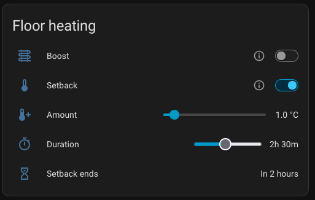
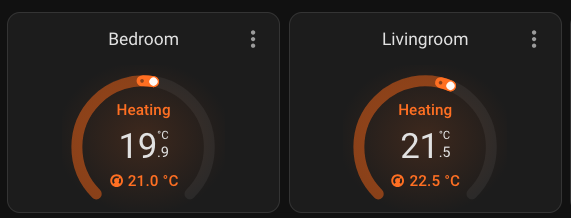

# Heat Flex

Shift your heating in time. A Home Assistant integration that temporarily
raises (**Boost**) or lowers (**Setback**) the target temperature of selected
thermostats, then puts each one back to the target it had before. Heat the
house a little more when energy is cheap or plentiful, a little less when it
is expensive or scarce, and let the building's thermal mass carry the
difference. Underfloor heating is the ideal case, but any `climate` entity
works.

- **Boost** when you have more energy than you need: the battery is full and
  the sun is still producing, electricity is cheap right now, or an expensive
  hour is coming and you want to preheat. Instead of exporting the surplus,
  store it as heat by raising every thermostat by 1 °C for 2 hours.
- **Setback** when energy is scarce or expensive: a price peak, a low battery,
  or a grid alert. Lower every thermostat by 1 °C for 2 hours and let the
  house coast on the heat already in it.

Both use the same **Amount** and **Duration** settings. Only one of the two
runs at a time; starting one ends the other. Control them from the UI, or
start them from automations with your own conditions (electricity price,
battery level, PV power, outdoor temperature, ...). Every start is recorded,
so you can always see which automation did what and when.

> Heat Flex was called **Solar Floor Boost** up to version 1.10. The
> integration's domain, entity IDs and action names keep that name
> (`solar_floor_boost`), on existing and on new installs, so nothing changes
> in automations and dashboards after the update, and examples work for
> everyone.

Temperatures follow your Home Assistant unit system: with Fahrenheit the
amount is in °F (default 2 °F, whole degrees) and so are the limits (defaults
82 °F and 59 °F).



A setback of 1 °C running for 2 h 30 m. The thermostats keep heating, just a
degree lower, and go back to their own targets when it ends:



## Installation

### Marketplace (Home Assistant 2026.11 or newer)

[](https://my.home-assistant.io/redirect/hacs_repository/?owner=alarmatwork&repository=ha-solar-floor-boost&category=integration)

Settings → **Marketplace** → search for **Heat Flex** (or click the
badge above). Install it, then restart Home Assistant.

### HACS (Home Assistant 2026.10 or older)

HACS → search for **Heat Flex** (or click the badge above). Install
it, then restart Home Assistant.

### Manual

Copy `custom_components/solar_floor_boost` to
`<config>/custom_components/solar_floor_boost` and restart Home Assistant.

### Setup

Settings → Devices & services → **Add integration** → **Heat Flex**.
Pick the thermostats, a maximum boosted target (safety cap, default 28 °C) and
a minimum setback target (safety floor, default 15 °C). You can change them
later via **Configure**.

## Entities

| Entity | Purpose |
| --- | --- |
| `switch.solar_floor_boost_boost` | On starts a boost with the amount and duration below; off stops it and restores the original targets. Turning it on during a setback ends the setback. While on, attributes say who started it and with what (see [Automations](#automations)). |
| `switch.solar_floor_boost_setback` | On starts a setback with the same amount and duration; off stops it and restores the original targets. Turning it on during a boost ends the boost. Same attributes. |
| `number.solar_floor_boost_amount` | Degrees to add (boost) or subtract (setback): default 1 °C in 0.5 steps, or 2 °F in whole degrees. |
| `number.solar_floor_boost_duration` | Hours in 15-minute steps, shown as "4h 45m" (default 2h, max 12h). The dashboard card shows it as a preset slider: 15m, 30m, 45m, 1h, 1h 30m, 2h, 2h 30m, 3h, 3h 30m, 4h, 5h, 6h, 8h, 12h. Up to 1.5.x this entity was in minutes. |
| `sensor.solar_floor_boost_boost_ends` | When the boost ends. Attributes list each thermostat's original (`baseline`) and boosted (`target`) value. |
| `sensor.solar_floor_boost_setback_ends` | When the setback ends. Attributes list each thermostat's original (`baseline`) and lowered (`target`) value. |

Installs made before 1.7.1 keep their old entity IDs,
`number.solar_floor_boost_boost_amount` and `..._boost_duration`; only the
names changed. Home Assistant 2026.11+ may also prefix new entity IDs with
the device's area.

## Dashboard card

The integration ships the card shown above. Edit dashboard → **Add card**
→ **By card** (or **Browse all cards**) → **Heat Flex**. On Home
Assistant 2026.6+ it is also suggested under **By entity** (Community section)
when you pick any Heat Flex entity. The ⓘ next to each switch explains
when to use that mode (hover, or tap on a phone).

```yaml
type: custom:heat-flex-card
title: Heating         # optional
end_format: relative   # optional: relative, time, datetime, ...
```

If you prefer a plain entities card that you can customise:

```yaml
type: entities
title: Heating
show_header_toggle: false
entities:
  - type: custom:heat-flex-switch-row  # toggle with an ⓘ hint
    entity: switch.solar_floor_boost_boost
    name: Boost
    hint: Use when the battery is full or electricity is cheap.
  - type: custom:heat-flex-switch-row
    entity: switch.solar_floor_boost_setback
    name: Setback
    hint: Use when electricity is expensive or the battery is low.
  - entity: number.solar_floor_boost_amount
    name: Amount
  - type: custom:heat-flex-duration-row  # preset slider (15m … 12h)
    entity: number.solar_floor_boost_duration
    name: Duration
  - type: conditional
    conditions:
      - entity: switch.solar_floor_boost_boost
        state: "on"
    row:
      entity: sensor.solar_floor_boost_boost_ends
      name: Boost ends
      format: relative
  - type: conditional
    conditions:
      - entity: switch.solar_floor_boost_setback
        state: "on"
    row:
      entity: sensor.solar_floor_boost_setback_ends
      name: Setback ends
      format: relative
```

### History card

A second ready-made card draws the day as a timeline: red blocks while a
boost ran, blue while a setback did, and a "now" marker. Hover or tap a block
and it tells who started that session, the amount, the start and end time,
and the fields the caller gave. Edit dashboard → **Add card** →
**Heat Flex History**.

```yaml
type: custom:heat-flex-history-card
title: Heating today        # optional
span: today                 # optional: today (calendar days) or rolling (a window ending now)
days: 1                     # optional, span today: 1 = today, 2 = since yesterday, ... up to 14
hours: 24                   # optional, span rolling: how far back, up to 336
```

Two flavours are in the card picker: **Heat Flex History** shows the
current day from midnight, with the "now" marker moving along; **Heat Flex
History (last 24 h)** shows a rolling window that ends now, so what
happened last evening is still on it in the morning. Both are the same card;
the second one is `custom:heat-flex-history-24h-card`, which just
presets `span: rolling` and `hours: 24`.

Card types from before 2.0 (`custom:solar-floor-boost-card` and the
others) keep working as aliases.

The card reads the recorder's history of the two switches, so it needs the
recorder (on by default) and shows sessions as far back as it keeps data.
Colours follow the theme's `--error-color` and `--info-color`; override them
with `--heat-flex-boost-color` and `--heat-flex-setback-color`
in a theme.

## Actions

```yaml
action: solar_floor_boost.start
data:
  delta: 2          # degrees in your unit, optional, defaults to Amount
  duration: 120     # minutes (any value), optional, defaults to Duration
  climate_entities: # optional, defaults to all configured thermostats
    - climate.living_room
  automation: "{{ this.attributes.friendly_name }}"  # who is calling, see below
```

```yaml
action: solar_floor_boost.stop
```

The setback actions take the same fields:

```yaml
action: solar_floor_boost.start_setback
data:
  delta: 2          # degrees in your unit, optional, defaults to Amount
  duration: 60      # minutes (any value), optional, defaults to Duration
  climate_entities: # optional, defaults to all configured thermostats
    - climate.living_room
  automation: "{{ this.attributes.friendly_name }}"
```

```yaml
action: solar_floor_boost.stop_setback
```

Each `stop` action only ends its own mode, so an automation that stops the
boost never cuts a setback short, and vice versa. Starting one mode while the
other runs ends the other first.

## Automations

The integration is built to be driven by automations: you decide *when*
energy is plentiful or scarce, it handles the thermostats. The rules below
are everything an automation needs to know; for a machine-readable version
of the same, see the [integration guide](docs/integration-guide.md).

### How to call it

Use the actions, not the switches. An action takes the amount, the duration
and the thermostats for this one session, and it can say who is calling:

```yaml
actions:
  - action: solar_floor_boost.start          # or solar_floor_boost.start_setback
    data:
      delta: 1.5                             # optional: degrees, defaults to the Amount entity
      duration: 90                           # optional: minutes, defaults to the Duration entity
      climate_entities:                      # optional: defaults to all configured thermostats
        - climate.living_room
      automation: "{{ this.attributes.friendly_name }}"   # who is calling (see below)
```

- Omit `delta` and `duration` to let the user tune them in the card. Give
  them when the automation knows better (a short setback for a 15-minute
  price peak).
- `solar_floor_boost.stop` and `solar_floor_boost.stop_setback` end their own
  mode only. A stop for the other mode does nothing, so an automation can't
  accidentally cut the other one short.
- Starting a mode that is already running applies the new amount to the
  original targets (no stacking) and restarts the timer from now. Starting
  the other mode ends the running one first.
- `switch.turn_on` on the Boost/Setback switch also works, with the Amount and
  Duration entities, but it can't carry a name, so prefer the actions.

### Say who is calling

Give the `automation` field in every automation and script that calls a
start action. `"{{ this.attributes.friendly_name }}"` fills in the
automation's own name, so the line can be copied unchanged into any
automation. A script can use its own name the same way, or any text.

Calling a start action from an automation **without** the field still works
but is deprecated: the entities can then only say "Started by an
automation", and the first such call after a restart logs a warning with
the line to add.

### What gets recorded

Every start is recorded, so when a boost or setback appears out of nowhere
you can see where it came from. The `Boost`/`Setback` switch and the
`Boost ends`/`Setback ends` sensor of the running mode carry these attributes
(they survive a restart and are cleared when the session ends):

| Attribute | Example |
|---|---|
| `started_at` | `2026-11-18T09:30:00+00:00` |
| `started_by` | `manual` (a person: the card, the more-info dialog, developer tools) or `automation` (an automation or script, decided from the call's context) |
| `automation` | `Solar surplus - boost floor heating`, the name given in the `automation` field, otherwise `null` |
| `command` | `solar_floor_boost.start`, `solar_floor_boost.start_setback` or `switch.turn_on` |
| `parameters` | `{"delta": 2, "duration": 120}`: the fields given with the action, not the defaults filled in |
| `delta` | `2`: the amount actually applied (switch only; the sensor has it too) |

Where to look:

- **The card** shows "Started by Solar surplus - boost floor heating" or
  "Started manually" under the switch while the mode runs.
- **The history card** shows the day's sessions as blocks; each block's
  tooltip has the same information plus the start and end time.
- **The log** gets one line per start:
  `Boost +1.0°C until 11:30 for ['climate.living_room'], started by automation 'Solar surplus' via solar_floor_boost.start {'duration': 120}`.
- **Automations** can use the attributes too, e.g. a condition that only
  stops a setback its own automation started:

```yaml
conditions:
  - condition: template
    value_template: >-
      {{ state_attr('switch.solar_floor_boost_setback', 'automation')
         == this.attributes.friendly_name }}
```

### Useful conditions and triggers

- `switch.solar_floor_boost_boost` / `..._setback` is `on` while the mode
  runs: a condition for "not already running", or a trigger for "it ended".
- `sensor.solar_floor_boost_boost_ends` / `..._setback_ends` is the end time
  (a timestamp sensor), `unknown` when the mode is not running. Its
  attributes `boosted` / `setback` list each thermostat's original
  `baseline` and current `target`; `pending_restore` lists thermostats that
  couldn't be restored yet (unavailable).
- A boost lasts `duration` minutes and then ends by itself. For "as long as
  the condition holds", re-trigger every few minutes and start again when
  the switch is `off` (the examples below do this), or start once and stop
  with the stop action when the condition clears.

## Example automation: boost with solar surplus

[examples/solar_surplus_automation.yaml](examples/solar_surplus_automation.yaml)
boosts all configured thermostats for 2 hours when all of these are true:

| Condition | Rule |
| --- | --- |
| Battery | state of charge above **90 %** |
| Sunshine left by the clock | after sunrise and at least **2 h before sunset**, so the boost ends while the sun is still up |
| Sunshine left by the forecast | more than **3 kWh** still forecast for today |
| Outside temperature | below **20 °C** |
| Not already boosting | the Boost switch is off |

It checks when the battery has been above 90 % for 5 minutes and every 10
minutes after that, so while the conditions hold a new boost starts after each
one ends. The amount comes from the **Amount** entity; add `delta: 2`
under `duration` to fix it in the automation instead.

### Solar forecast (optional, recommended)

The "sunshine left" check uses the
[Forecast.Solar](https://www.home-assistant.io/integrations/forecast_solar/)
integration, which estimates your panels' production from the weather
forecast. It's free and needs no account.

1. Settings → Devices & services → **Add integration** → **Forecast.Solar**.
2. Enter your panels' **latitude/longitude** (defaults to your home location),
   **declination** (tilt: 0° flat, 90° vertical), **azimuth** (180° = south),
   and **total modules power** in Wp. Add the integration once per roof
   plane if your panels face different directions.
3. Use its **Estimated energy production - remaining today** sensor (kWh) in
   the automation. The entity ID is usually
   `sensor.energy_production_today_remaining`; check
   Developer Tools → States, as it can have a suffix (for example after
   renaming the service or adding a second plane).

Without Forecast.Solar, delete that condition, or replace it with a check on
your inverter's current PV power, for example:

```yaml
  - condition: numeric_state
    entity_id: sensor.pv_power   # your inverter's PV power in W
    above: 1500
```

### Deploy the automation

1. Settings → Automations & scenes → **Create automation** →
   **Create new automation** → ⋮ → **Edit in YAML**.
2. Paste the example and replace the entity IDs with your own:
   `sensor.battery_soc` (battery state of charge, %),
   `sensor.energy_production_today_remaining` (Forecast.Solar) and
   `weather.home` (any weather entity).
3. **Save**. To test it, open the automation → ⋮ → **Run actions**: that starts
   a boost immediately, ignoring the conditions.

In the automation editor, each condition shows a live ✓ or ✕: whether it's
true right now. A ✕ is not an error, just a condition that currently blocks
the boost (for example a boost already running).

## Example automation: set back when energy is expensive

[examples/expensive_energy_setback.yaml](examples/expensive_energy_setback.yaml)
lowers all configured thermostats for 1 hour whenever the electricity price is
above a limit, re-checking every 10 minutes so the setback continues for as
long as the price stays high. Replace `sensor.electricity_price` with your
price sensor (for example from the Nord Pool, Tibber or ENTSO-e integrations)
and `0.30` with your limit in its unit. The amount comes from the **Amount**
entity; add `delta: 2` under `duration` to fix it in the automation.

## Behaviour

Everything below applies to a setback as well as a boost; a setback just
moves the targets down instead of up.

- **Boost and setback never run together.** Starting one while the other runs
  restores the original targets first, then applies the new mode to them.
- **Original targets are remembered** per thermostat and restored when the
  boost ends. They are saved to disk, so a restart during a boost still
  restores them (right after startup if the end time passed while Home
  Assistant was down).
- **Manual changes win.** If a thermostat's target changed during the boost
  (by you, a schedule or an app), it is left as is at the end.
- **Starting again during a boost** applies the new amount to the original
  targets instead of stacking, and restarts the timer.
- All selected thermostats are boosted, whatever their mode (heat, off, idle).
  Thermostats that are **unavailable** at start are skipped. One that
  is unavailable when the boost ends is restored as soon as it comes back
  (listed in the sensor's `pending_restore` attribute).
- The boosted target is rounded to the thermostat's temperature step (0.5 °C
  or 1 °F if the thermostat doesn't report one) and capped at the configured
  maximum and the thermostat's own `max_temp`. A setback target is floored at
  the configured minimum and the thermostat's `min_temp`.
- Amount and limits are in the system's temperature unit. If you switch the
  unit system later, the saved amount is converted; re-check the two limits
  under **Configure**.
- Removing the integration restores all thermostats.

## Integration guide for LLMs

[docs/integration-guide.md](docs/integration-guide.md) is a compact,
self-contained description of the integration: entities, actions and their
fields, attributes, rules, and the recommended automation patterns. Paste it
into the prompt (or point the assistant at the file) when you ask an LLM to
write automations, scripts or dashboards for Heat Flex; it has
everything needed without reading the code.

## Development

```bash
python -m venv .venv && . .venv/bin/activate
pip install -r requirements_test.txt
pytest
```

## Releasing

Bump `version` in `custom_components/solar_floor_boost/manifest.json` and
`CARD_VERSION` in `frontend/solar-floor-boost-card.js` (a test checks they
match) and push to `main`. The Release workflow regenerates
[CHANGELOG.md](CHANGELOG.md) from the commit history, commits it, and
publishes a GitHub release `v<version>` whose notes are that version's
section. The Marketplace and HACS offer the release as an update and show
those notes in Home Assistant.

Commit subjects are the changelog lines, so write each as the sentence a
user should read ("Setback never goes below the thermostat's minimum").
Conventional prefixes (`feat:`, `fix:`, `docs:`) sort a commit into Added,
Fixed or Documentation; without one, the first word decides (see
`cliff.toml`). Subjects starting with "Release " are left out.

After an update, open dashboards notice that the running integration is
newer than the card they loaded: a notice row with a **Reload** button
appears at the top of the card, and a tab that is in the background reloads
by itself.

## License

MIT
